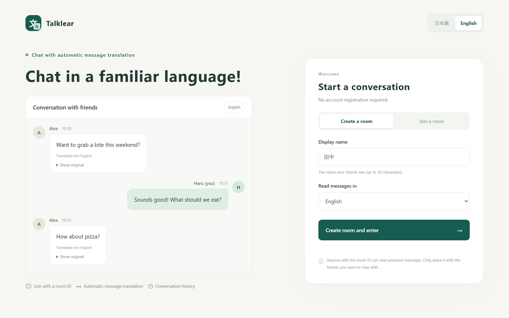
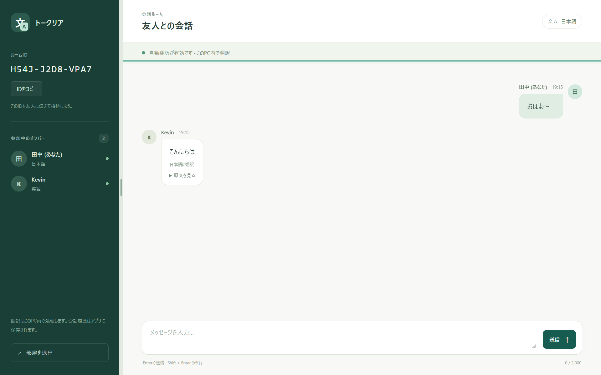

<h1 align="center">💬 Talklear</h1>

<p align="center">
  <b>日英の端末内翻訳で、言葉をつなぐルームチャット。</b><br>
  コード・設計・タスク・検証をまとめた Development Workspace
</p>

<p align="center">
  
  
  
  
</p>

<p align="center">
  <a href="#screenshots">使用イメージ</a> ·
  <a href="#quickstart">クイックスタート</a> ·
  <a href="#features">主な機能</a> ·
  <a href="#technology">技術構成</a> ·
  <a href="#documentation">ドキュメント</a> ·
  <a href="#verification">検証</a> ·
  <a href="https://airy-mantis-6f3.notion.site/Talklear-Development-Workspace-404bfd032199810eac93f56f7cf89f99">Notionダッシュボード</a>
</p>

---

Talklearの日英翻訳チャットのコード、設計、タスク、検証を管理する個人用ワークスペースです。開発記録は工程モデルとして整理しており、出典と実測の区分は[管理用資料](docs/admin/record-sources.md)に集約しています。

<a id="screenshots"></a>

## アプリの使用イメージ

### ホーム画面（英語表示）

表示名とメッセージを読む言語を選び、部屋の作成・参加ができます。画面の表示言語は日本語・英語に切り替えられます。



### チャット画面（日本語表示）

同じルームに参加した相手と会話できます。相手の英語のメッセージを日本語で読み、「原文を見る」で元のメッセージも確認できます。



<a id="quickstart"></a>

## ⚡ クイックスタート

**Docker Desktop**と**PowerShell**を用意し、リポジトリのルートで実行します。

```powershell
./Start-Docker.ps1
```

停止するときは、次のコマンドを実行します。

```powershell
./Stop-Docker.ps1
```

元アプリとCompose名が同じため、既存の環境と同時に再作成テストを行わないでください。パスワードや実データはGit管理外の`.local/`へ保存します。

### 📦 Dockerを使わずに起動する

```powershell
./Setup.ps1
./Start-App.ps1
```

<a id="features"></a>

## 🎯 主な機能

- **ルームチャット** — 部屋の作成・参加と、原文メッセージの送受信。
- **メッセージ保存** — PostgreSQLへの保存と履歴の取得。
- **日英の端末内翻訳** — Chrome Translator / LanguageDetectorを使用。
- **原文表示** — 翻訳に加えて、元のメッセージも確認。

<a id="technology"></a>

## 🧩 技術構成

| 領域 | 使用技術 |
| :--- | :--- |
| バックエンド | Java 21 / Spring Boot 3.5.16 / Spring JDBC |
| フロントエンド | HTML / CSS / JavaScript |
| データベース | PostgreSQL |
| 翻訳・言語判定 | Chrome Translator / LanguageDetector |

📖 [アーキテクチャ](docs/design/architecture.md) · [API設計](docs/design/api.md) · [DB設計](docs/design/database.md)

<a id="documentation"></a>

## 📚 ドキュメント

| 分類 | 資料 |
| :--- | :--- |
| 企画・要件 | [要件](docs/requirements.md) · [計画](docs/project/master-plan.md) |
| 開発管理 | [開発日程](docs/project/timeline.md) · [チーム](docs/project/team.md) · [ID台帳](docs/project/id-ledger.json) |
| 設計 | [技術設計](docs/design/architecture.md) · [API](docs/design/api.md) · [DB](docs/design/database.md) |
| 公開・運用 | [アプリ公開設定](docs/deployment.md) |
| 品質・記録 | [テスト計画](docs/testing/plan.md) · [記録の出典](docs/admin/record-sources.md) · [過去の非公開監査結果](reports/private-workspace-audit.md) |

<a id="verification"></a>

## 🧪 検証

記録の整合性とブラウザロジックを、次のコマンドで確認できます。

```powershell
python scripts/verify_records.py
node --test tests/translator.test.mjs tests/message-feed.test.mjs
```

`verify_records.py`は、ID・日程・参照・出典・アクセス証拠・ソースハッシュを照合します。

### 🔎 Java / DB・Dockerの検証コマンド

Java / DBは準備済みのテスト環境で実行します。

```powershell
./Test-App.ps1
```

Docker結合は独立環境で実行します。

```powershell
./Test-Docker.ps1
```

実測の結果と未実行項目は、[テスト記録](docs/testing)を参照してください。

> ※ 関連資料：[Notionダッシュボード](https://airy-mantis-6f3.notion.site/Talklear-Development-Workspace-404bfd032199810eac93f56f7cf89f99)
