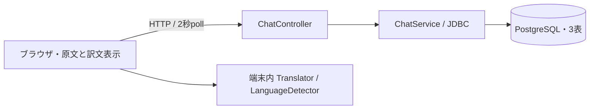

# 現行アーキテクチャ（現在の実装で確認）

Spring Boot 3.5.16 / Java 21 / Spring JDBC、HTML/CSS/JavaScript、PostgreSQL。pom.xmlで確認。画面とJSON APIは同一アプリから配信する。WebSocket・外部翻訳サーバーは実装されていない。

chatトークンはsessionStorageへ保存。翻訳結果はメモリ上の最大500件キャッシュ。原文はサーバーとDBへ渡るため「すべて端末内」とは説明しない。翻訳準備はユーザー操作で開始し、失敗時は原文へ戻す。

SecurityHeadersはCSP・Permissions-Policy・no-store・Origin確認・POST16KiB上限を提供。Originがないリクエストは拒否しないため、本人認証や非ブラウザクライアントの排除にはならない。RequestLimitsはJVM内の時間窓であり分散制限ではない。ApiErrorsはDB例外を503 STORAGE_ERRORへ写像する。